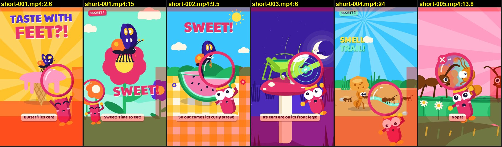
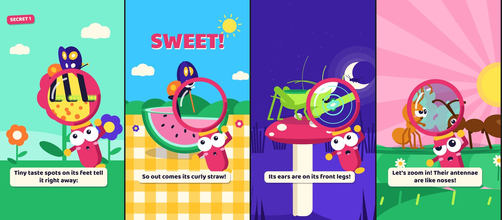

# Phân tích toàn diện 5 Short của "Big Secrets of Tiny Bugs"

Ngày 09/11/2026. Thực hiện theo yêu cầu trong [`Task.md`](../Task.md): phân tích từng Short từ khung đầu đến khung cuối, theo 12 mục.

| Short | Đề tài | Loại | Điểm tổng | Báo cáo |
|---|---|---|---|---|
| SHORT-001 | Bướm nếm bằng chân, dế nghe bằng chân, ong nói bằng điệu nhảy | Tập A, 52 s | **6,1** | [SHORT-001.md](SHORT-001.md) |
| SHORT-002 | Bướm nếm bằng chân, duỗi vòi hút | Bản B, 22 s, lặp | **7,3** | [SHORT-002.md](SHORT-002.md) |
| SHORT-003 | Dế có tai ở chân trước | Bản B, 24 s, lặp | **7,1** | [SHORT-003.md](SHORT-003.md) |
| SHORT-004 | Kiến ngửi bằng râu, đi theo mùi, nuôi rệp (Crumb ra mắt) | Tập A, 52 s | **6,3** | [SHORT-004.md](SHORT-004.md) |
| SHORT-005 | Kiến chào nhau bằng râu | Bản B, 24 s, lặp | **7,0** | [SHORT-005.md](SHORT-005.md) |

Không phân tích: pilot `films/bi-mat-ti-hon/` (SHORT-001 là bản dựng lại của pilot) và video dài LONG-001.

**Kế hoạch nâng cấp:** [KE-HOACH-NANG-CAP.md](KE-HOACH-NANG-CAP.md) (09/11/2026).
- Năm tập này giữ nguyên làm mốc so sánh.
- Từ SHORT-006: tập A dài khoảng 45 s, logo ≤ 0,8 s, và có các quy tắc mới trong `QUALITY.md` và `qa.py`.

## Kết luận chính

1. **Về kỹ thuật, cả 5 tập đều sạch.** `qa.py` chạy lại hôm nay cho 33–34/34 mục ĐẠT ở mọi tập. Âm lượng, độ rõ lời, mật độ tiếng động, nhạc đổi cảnh, màu và vòng lặp đều đạt ngưỡng của [`_shared/QUALITY.md`](../_shared/QUALITY.md).
2. **Điểm yếu nằm ở thứ máy chưa đo: nhịp kể chuyện giữa phim.** Đoạn trũng lặp lại theo cùng một mẫu ở cả 5 tập: kính đứng yên trên một hình nhỏ và trừu tượng, rồi cảnh sổ đứng yên với câu "Six legs? In you go!", ở tập A thêm những đoạn dài không lời.
3. **Bản B (22–24 s) mạnh hơn tập A (52 s)** khoảng 1 điểm. Bản B ngắn, lặp liền, một bí mật và một gag. Hai tập A đều có logo 2 s ngay sau móc, một cảnh giới thiệu lặp lại, và một cảnh tóm tắt 8–10 s.
4. **Bí mật khoa học, tức "khoảnh khắc wow", luôn nằm trong một cái kính rộng khoảng 30 % khung.** Đó là hình quan trọng nhất của mỗi tập nhưng cũng nhỏ và khó đọc nhất ([xem ảnh](#hình-trong-kính)).
5. **Phụ đề và mặt Miss Loupe hay rơi vào vùng giao diện YouTube Shorts che** ([xem ảnh](#vùng-giao-diện-youtube-che)).

## Bảng điểm so sánh

Điểm 0–10. Trọng số do mình đặt, ưu tiên các tiêu chí quyết định người xem ở lại: Hook và Retention 15 %, Pacing 12 %, Storytelling 10 %.

| Tiêu chí | Trọng số | 001 | 002 | 003 | 004 | 005 |
|---|---|---|---|---|---|---|
| Hook | 15 % | 7 | **8** | 7 | 6 | 6 |
| Storytelling | 10 % | 6 | 7 | 7 | 7 | 7 |
| Pacing | 12 % | 5 | 6 | 6 | 5 | 6 |
| Visual | 8 % | 7 | 7 | 7 | 6 | 6 |
| Audio | 7 % | 8 | 8 | 8 | 8 | 8 |
| Character Consistency | 5 % | 9 | 9 | 9 | 9 | 9 |
| Engagement | 8 % | 6 | 7 | 7 | 7 | **8** |
| Retention Potential | 15 % | 5 | 7 | 7 | 5 | 7 |
| Ending | 7 % | 7 | 8 | 7 | 7 | **8** |
| Loop Potential | 6 % | 4 | 8 | **9** | 7 | 8 |
| Viral Potential | 7 % | 5 | 6 | 6 | 6 | 6 |
| **Tổng có trọng số** | 100 % | **6,1** | **7,3** | **7,1** | **6,3** | **7,0** |

Audio có trần 8 ở mọi tập vì mình không nghe trực tiếp (xem [Cách phân tích](#cách-phân-tích)).

## Vấn đề chung của cả kênh

| # | Vấn đề | Bằng chứng | Tập bị |
|---|---|---|---|
| 1 | **Kính đứng yên trên hình trừu tượng** | Khung gần như không đổi trong 2–5,5 s lúc kính soi: 001 ở 9–13 s (chuyển động 0,35–2,1), 002 ở 4,5–8 s (0,23–0,76), 003 ở 4–9,5 s (0,48–2,3), 004 ở 10–12 s (0,63–0,79), 005 ở 6–10,5 s (0,19–0,92) [Đo] | 5/5 |
| 2 | **"Six legs? In you go!" luôn đứng yên** | Chuyển động 0,07–1,06 trong 1,5–2,5 s lúc câu được nói: 001 ở 42–44 s, 002 ở 15–17 s, 003 ở 13,5–15 s, 004 ở 38–40 s, 005 ở 16–18,5 s [Đo] | 5/5 |
| 3 | **Đoạn dài không lời ở tập A** | 001: 33,3–42,0 s (8,7 s). 004: 21,7–30,3 s (8,6 s) và 32,0–38,0 s (6 s) [Đo] | 001, 004 |
| 4 | **Logo 2 s ngay sau móc, rồi giới thiệu lặp lại** | 001: logo 4–6 s, rồi "A butterfly lands on a flower" ở 6–9,6 s. 004: logo 4–6 s, khung trống 6,0 s, "This is Crumb, the ant!" ở 6,5 s [QS] | 001, 004 |
| 5 | **Cảnh sổ tóm tắt dài** | 001: 40–48 s; 004: 36–45,5 s (gần đứng yên 7 s) [Đo] | 001, 004 |
| 6 | **Bố cục chạm vùng giao diện YouTube** | Phụ đề ở khoảng 1460–1620 px (76–84 % chiều cao); mặt Loupe ở góc dưới phải trong 001 (1,75–3 s), 004 (20–27 s), 005 (5 s, 13,8 s) [QS + ước lượng vùng] | 5/5 |
| 7 | **Người nói không có trên hình** | 003: "NOPE!" và "Oops! Sorry!" là giọng Loupe khi Loupe vắng mặt (17,7–20,3 s). 002: câu hỏi cuối cũng vậy (20,45 s) [QS] | 002, 003 |
| 8 | **Móc dựa vào chữ hơn là vào hình** | Chuyển động 1–2,5 s chỉ khoảng 1,0 ở 003 và 005; nhân vật chính bị che tới 2 s ở 004 [Đo/QS] | 003, 004, 005 |

**Điểm mạnh nên giữ:**
- Chữ móc to, đủ ở khung 0, nảy có tiếng.
- Trò đố "On its head? Nope!" và "So, they follow a map? Nope!".
- Chuyển cảnh qua kính và chụp sticker.
- Gag kết dùng lại chính bí mật của tập (002, 003, 005).
- Câu hỏi cuối để trẻ trả lời to hoặc làm theo (002–005).
- Crumb: giọng trẻ em, có ước muốn, nói thẳng với khán giả.
- Trứng phục sinh Rollo và Spindle.

## Kế hoạch ưu tiên cho cả kênh

Chi tiết theo timestamp nằm ở mục 11 của từng báo cáo. Đây là phần gom lại.

| Ưu tiên | Việc | Áp dụng | Tác động dự kiến [DĐ] |
|---|---|---|---|
| 1 | Biến cảnh kính soi thành hành động: kính khoảng 60 % khung, bí mật "xảy ra" (chân bước sáng lên, trống rung theo tiếng, mây mùi hòa vào nhau), mỗi nhịp một tiếng | 5 tập | Bớt điểm rơi lớn nhất của mỗi tập |
| 1 | Gộp "Six legs? In you go!" với một hành động (Albie đớp sticker, nhân vật nhảy vào sổ đúng lúc nói) | 5 tập và các tập sau | Bớt 2–2,5 s đứng yên mỗi tập |
| 1 | Tập A: rút logo còn ≤ 0,8 s và lồng vào cú lao vào kính, hoặc dời xuống cuối; cắt cảnh giới thiệu lặp lại | 001, 004 | Bớt điểm rơi ở giây 4–9 |
| 1 | Tập A: không để đoạn nào quá 4 s không lời; rút cảnh sổ còn 3–4 s | 001, 004 | Bớt hai đoạn trũng |
| 2 | Tập A có vòng mở: ba ô sticker "1 2 3" từ móc | 001, 004 | Lý do để xem hết |
| 2 | Người nói phải có mặt trên hình; Crumb nói nhiều hơn | 002, 003, 004, 005 | Gag rõ hơn |
| 2 | Móc bằng hình: va chạm hoặc phản ứng mạnh trong 1 s đầu (phương án móc ở mục 2 mỗi báo cáo) | 003, 004, 005 | Nhiều người dừng lướt hơn |
| 3 | Phụ đề lên khoảng 1250–1400 px; mặt Loupe trên 1450 px và trái 900 px | 5 tập | Không mất chữ và biểu cảm |
| 3 | Chữ trên nền sáng có viền tối hoặc nền đặc | 004 | Đọc được |
| 3 | Đổi nền hồng của 005 | 005 | Loupe nổi |

### Đề xuất cho quy trình kiểm

Đã chốt ngày 09/11/2026 và đưa vào `QUALITY.md` và `qa.py`, xem [kế hoạch nâng cấp](KE-HOACH-NANG-CAP.md#5-quy-tắc-mới-và-cách-kiểm). Phần dưới giữ nguyên như lúc đề xuất.

`qa.py` cho mọi tập ĐẠT, nhưng ba vấn đề chung ở trên lọt qua vì các quy tắc hiện tại không đo chúng:

| Lọt qua | Vì sao | Có thể thêm vào `QUALITY.md` / `qa.py` |
|---|---|---|
| 8,7 s không lời ở 001 | "Khoảng chết" chỉ tính khi không lời **và** không tiếng động; nhạc và vài cue là đủ để đạt | Đoạn không lời dài hơn 4 s → CẢNH BÁO, trừ khi có chữ trên hình hoặc hành động mới mỗi 2 s |
| Kính đứng 2–5,5 s | "Hình đứng yên" chỉ tính khi không có lời | Chuyển động thấp kéo dài hơn 3 s → CẢNH BÁO, kể cả khi đang có lời (ngưỡng cần thử trên 5 tập này trước, ví dụ dưới 1,0 hoặc dưới 1,5) |
| Phụ đề và Loupe trong vùng giao diện | Chưa có quy tắc về vùng an toàn | Phụ đề và mặt nhân vật không nằm dưới 1500 px hoặc phải 940 px |

Tập A đang có quy tắc "nhạc hiệu 2 s chỉ sau móc". Đề xuất rút logo đi ngược quy tắc đó, nên cần chủ kênh quyết.

**Ngày 09/11, chủ kênh đã chọn** rút logo còn ≤ 0,8 s và lồng vào cú lao vào kính, áp dụng từ SHORT-007. Thay cho việc đăng hai bản, kênh sẽ so biểu đồ giữ chân ở giây 4–8 giữa 001, 004 (logo 2 s) và 007, 010 (logo ngắn).

## Vùng giao diện YouTube che

Sáu khung lấy từ năm Short. Vùng đỏ là ước lượng phần giao diện Shorts thường che trên điện thoại: thanh trên 150 px, cột nút bên phải (x ≥ 940 px, y 880–1780 px), và vùng tên kênh, tiêu đề, nhạc (y ≥ 1530 px). Vị trí thật khác nhau theo máy và phiên bản ứng dụng.

Thấy được:
- Phụ đề nằm trên mép vùng dưới ở cả sáu khung.
- 001 ở 2,6 s: thân và chân Loupe trong vùng dưới, mặt sát cột nút.
- 004 ở 24 s: mặt Loupe nằm hẳn trong vùng dưới.
- 005 ở 13,8 s: Loupe trong vùng dưới.

## Hình trong kính

Bốn khung ở cỡ gần như trên điện thoại, đúng lúc lời đang nói bí mật. Từ trái: 001 ở 11,5 s (chân bướm và điểm nếm), 002 ở 10,0 s (vòi "curly straw"), 003 ở 6,0 s (tai trên chân dế), 005 ở 7,5 s (mây mùi).

Kính rộng khoảng 30 % khung. Vòi bướm ở 002 là một nét mảnh chừng 3 % chiều rộng. Mây mùi ở 005 là những vệt xanh ngọc không có hình rõ.

## Cách phân tích

- **Hình.** Tách khung từ file `.mp4` cuối: 4 khung/s cho 3 s đầu; 1 khung/s cho tập 52 s và 2 khung/s cho tập 22–24 s ở phần còn lại; dày hơn (3–10 khung/s) ở những chỗ cần soi. Các khung được ghép thành bảng có nhãn thời gian. Chuyển động giữa hai khung đã tách có thể bị bỏ sót.
- **Độ chuyển động.** Độ khác trung bình giữa hai khung liên tiếp (thang 0–255, 10 khung/s, ảnh xám 90×160). Dưới 1,0 là gần như đứng yên.
- **Âm thanh.** Đo mức (dBFS) từng giây của ba stem `out/stem_vox.wav`, `stem_mus.wav`, `stem_fx.wav` và của bản trộn; đếm cue trong `events.json`; đối chiếu `MUSIC.md`. **Mình không nghe trực tiếp được**, nên cảm xúc của giọng, độ hay của nhạc và độ khớp tinh tế giữa tiếng và hình chưa được đánh giá.
- **Lời.** Đối chiếu phụ đề `.srt` và `timeline.json`.
- **`qa.py`.** Chạy lại cho cả 5 tập ngày 09/11/2026: 001, 002, 003 được 33/33 ĐẠT; 004, 005 được 34/34 ĐẠT.
- **Ký hiệu.** **[QS]** thấy trực tiếp trên khung hình hoặc phụ đề. **[Đo]** số đo. **[DĐ]** dự đoán của AI.
- **Giữ chân.** Mọi nhận định về người xem rời đi hay xem lại là dự đoán, không phải số liệu YouTube Analytics. Sau khi đăng, hãy so các điểm rơi dự đoán với biểu đồ giữ chân thật.
- **Made for Kids.** Kênh đặt Made for Kids nên YouTube tắt bình luận. Các câu hỏi về "muốn bình luận" trong `Task.md` được thay bằng: câu hỏi để trẻ trả lời to, trò tìm đồ vật, vòng lặp.
- **"Nhân vật AI".** Nhân vật được vẽ bằng code (rig vector dùng chung), không phải ảnh do AI sinh. Mục 5 mỗi báo cáo vì vậy soi lỗi bố cục và dựng (cắt mép, che chữ, khung trống) thay cho lỗi kiểu ảnh AI.
- **Quan hệ với [`DANH-GIA-SHORTS.md`](../DANH-GIA-SHORTS.md).** Bản đánh giá ngày 06/11 kiểm theo bộ tiêu chí kỹ thuật và kết luận ĐẠT. Bản này nhìn từ phía người xem Shorts. Hai bản không mâu thuẫn: phim đạt chuẩn kỹ thuật, nhưng còn những đoạn trũng mà bộ chuẩn hiện tại chưa bắt.
