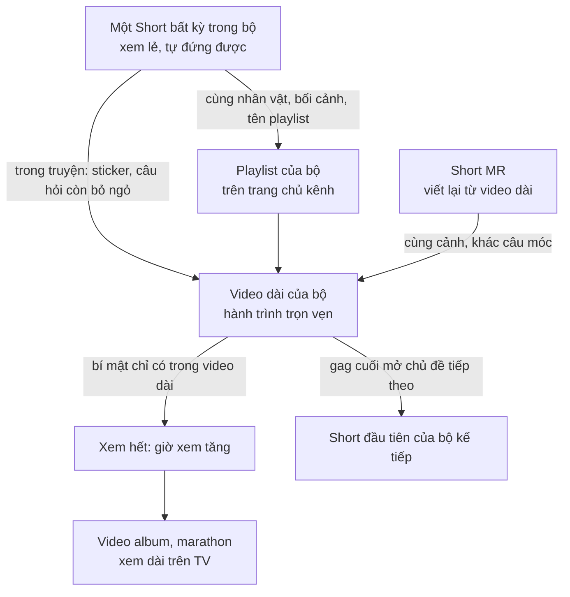
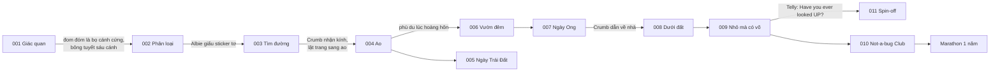

# Big Secrets of Tiny Bugs — Quy hoạch nội dung theo bộ

> Quy hoạch hệ thống kịch bản theo mô hình **một bộ = một chủ đề lớn + nhiều Shorts + một video dài**, xây trên [KE-HOACH-PHAT-TRIEN-KENH.md](KE-HOACH-PHAT-TRIEN-KENH.md).
> Gồm hai file:
> - **File này:** phân tích kế hoạch (Phần 1), Cấp độ 1 và 2, liên kết Shorts và video dài (Phần 4), lịch (Phần 5), quy chuẩn (Phần 6), danh sách thay đổi cần duyệt.
> - [**DE-CUONG-CAC-BO.md**](DE-CUONG-CAC-BO.md): Cấp độ 3, đề cương từng video.
>
> **Chưa có kịch bản Cấp độ 4.** Bạn chọn một bộ, mình viết bộ đó thành kịch bản sản xuất.
>
> Quy ước: **[Gốc §x]** là quy định có sẵn trong file kế hoạch. **(Đề xuất)** là phần mình bổ sung, chưa phải quy định gốc. Ký hiệu nguồn dữ kiện (**[Đã kiểm]**, **[Cao – chưa kiểm]**, **[CẦN XÁC MINH NGUỒN]**) giải thích ở đầu file đề cương.

---

## 0. Tóm tắt

| | |
|---|---|
| **Mô hình** | 10 bộ nội dung trong 12 tháng (11/2026–10/2027), cộng 1 bộ thử nghiệm spin-off (11/2027). Mỗi bộ có 4–23 Shorts và đúng **một video dài dựng mới** (định dạng C2 của kế hoạch, 4–7 phút). |
| **Tổng** | 151 Shorts (trong đó 8 Short mở rộng, phần lớn là tùy chọn), 10 video dài theo bộ, cộng 5 video "album" ngoài hệ bộ: hai bản trọn mùa, bài hát, câu đố, marathon. |
| **Giữ nguyên từ kế hoạch** | Mọi định dạng và thời lượng (§4), công thức tập A và bản B, nhịp tuần, dàn nhân vật và các luật dùng nhân vật (§2.5), quy trình dữ kiện, các ngày lễ, tất cả đề tài tập A. |
| **Thay đổi cần duyệt** | 1. Video dài của mỗi bộ là truyện dựng mới, không phải sổ tổng hợp. 2. Xếp lại thứ tự tập trong Mùa 2 và Mùa 3 theo bộ. 3. Dời 5 ngày ra video dài. 4. Viết lại 13 câu móc hoặc cảnh kết của bản B đang trùng với tập A. Chi tiết ở mục 7. |
| **Việc gấp nhất** | SERIES-001 lên sóng 16/11/2026. Video dài LONG-001 ra ngày 23/12 nên phải viết kịch bản **ngay tuần này**. Có phương án dự phòng nếu không kịp (mục 5.4). |

---

## 1. Phân tích file kế hoạch (Phần 1)

### 1.1 Định hướng nội dung

- **[Gốc §0]** Kênh khoa học thiếu nhi tiếng Anh, Shorts dọc, xây quanh Miss Loupe, chiếc kính lúp biết đi.
- **[Gốc §0]** Lời hứa của kênh: *"Every episode, Miss Loupe zooms in, and the garden reveals a secret."* Mỗi tập là một câu hỏi "bạn có làm được không?" và một con côn trùng làm được điều đó theo cách không ai ngờ.
- **[Gốc §0]** Tài sản riêng cần bảo vệ và lặp lại: thủ pháp **kính lúp phóng to thật**, khung trong khung.
- **[Gốc §0, §10]** Mục tiêu 12 tháng: đủ điều kiện YouTube Partner Program qua **giờ xem video dài**, không trông vào lượt xem Shorts.

### 1.2 Đối tượng khán giả

- **[Gốc §0]** Trẻ 4–8 tuổi xem cùng bố mẹ, tiếng Anh. Phụ huynh là người bật video và đăng ký kênh.
- **[Gốc §12]** Kênh đặt **Made for Kids**: không có bình luận, không xin thông tin của trẻ.
- **[Gốc §10]** Giáo viên là kênh lan truyền phụ (phiếu "Secret cards").

### 1.3 Phong cách kể và nhịp video

| Định dạng | Quy định | Nguồn |
|---|---|---|
| **A · Tập chính** | 45–60 s, dọc, 120 BPM: móc 0–3 s → tựa và nhạc hiệu 2 s → 3 bí mật (một bí mật có "Nope!") → sổ, giữ tĩnh ≥ 3 s → gag kết nối về câu móc | [Gốc §4.2] |
| **B · Một bí mật** | 15–25 s. Câu móc **riêng**, kết **riêng**, ảnh bìa riêng. Lời đọc chậm hơn tập A khoảng 15%, thêm một nhịp "ồ" sau đáp án | [Gốc §4.3] |
| **C1 · Sổ tổng hợp** | 6–10 phút, 4–7 tập A nối bằng khung truyện mới, ≥ 30% hình mới | [Gốc §4.4] |
| **C2 · Đặc biệt dựng mới** | 4–7 phút, 16:9 gốc, 100% mới | [Gốc §4.1] |
| **C3 · Trọn mùa** / **C4 · Marathon** | 15–20 phút / 45–60 phút | [Gốc §4.1] |
| **Bài hát** | 1,5–2 phút, chant đọc theo nhịp | [Gốc §4.1, §9] |

- **[Gốc §1.2]** Nhịp kể đặc trưng: đoán sai, lặng một nhịp, rồi đáp án là âm thanh đầu tiên sau khoảng lặng.
- **[Gốc §1.1]** Lời thoại khoảng 1,8 từ/giây.

### 1.4 Nhân vật

| Nhân vật | Vai trò trong tập | Lời | Nguồn |
|---|---|---|---|
| **Miss Loupe** | Dẫn chuyện. Tật: luôn đoán sai lần đầu vì nghĩ côn trùng giống người. Câu cửa miệng: "Let's zoom in!" · "Nope!" · "Secret unlocked!" · "Look closely!" | Có | [Gốc §2.1] |
| **Albie** | Cuốn sổ giữ luật "6 chân", chốt đáp án | 1–2 câu | [Gốc §2.3] |
| **Crumb** | Người xem đại diện: hỏi thay trẻ. Mạch truyện: xin cầm kính, nhận kính ở tập 12 | 1–3 câu | [Gốc §2.3] |
| **Spindle** | Muốn vào sổ; cải trang. Mang bài học phân loại | 1–2 câu | [Gốc §2.3] |
| **Blink** | Không giữ nổi bí mật; nguồn sáng của cảnh đêm | 1–2 câu | [Gốc §2.3] |
| **Mr. Rollo** | Trốn trong một khung của mọi tập ("Find Rollo!"); đi thẳng tắp | 1–2 câu, từ tập 11 | [Gốc §2.3] |
| **Dot** | Đếm to cùng trẻ | 1–2 câu | [Gốc §2.3] |
| **Flutter · Chirp · Waggle** | Nếm mọi thứ / nhạc công rụt rè / chỉ nhảy | Không lời (Chirp có từ đầu tiên ở Mùa 2 tập 5) | [Gốc §2.2] |
| **The Giant · Smudge** | Thời tiết của khu vườn / vết bẩn trên kính | Không lời | [Gốc §2.2] |
| **Uncle Telly** | Soi những thứ xa và to | Có lời từ Mùa 3; Mùa 1 chỉ lóe từ xa | [Gốc §2.2] |
| **Khách mời** | Côn trùng chính của từng tập, thiết kế một lần rồi dùng lại | Phần lớn không lời | [Gốc §2.3] |

Hình ảnh của 13 nhân vật định kỳ đã khóa trong [Character Design System](_shared/characters/CHARACTER-BIBLE.md).

### 1.5 Quy chuẩn xây dựng kịch bản

- **[Gốc §4.2]** Câu móc chọn một trong các mẫu: *Could you…? / Where are…? / What if you…? / Is a ___ a bug?*
- **[Gốc §4.2]** Khung chỉ là ngữ pháp. Mỗi tập phải có: côn trùng và bối cảnh mới, một cảnh đặc trưng riêng, một gag riêng, dữ kiện mới có nguồn, lời dẫn riêng.
- **[Gốc §2.5]**
  - Mỗi tập tối đa 3 nhân vật nói câu dài; ngoại lệ là tập kết mùa.
  - Mỗi tập tối đa một nhân vật mới.
  - Mỗi nhân vật một màu chủ đạo.
  - Vẽ đúng số chân.
  - Không có kẻ xấu thật.
- **[Gốc §11.1]** Mỗi tập phải có `FACTS.md` có nguồn, `TREATMENT.md` có cue map và ghi rõ khung nào Rollo trốn.
- **(Đề xuất)** Kế hoạch chưa quy định cho video dài. Mình đề xuất:
  - tối đa 4 nhân vật nói câu dài trong cả video, mỗi chương không quá 3;
  - mỗi video dài có ít nhất một bí mật chỉ có trong video dài.

### 1.6 Yếu tố hình ảnh và âm thanh dùng lại

- **[Gốc §2.6, §10]**
  - Kính phóng to; mỗi mùa thêm một chế độ kính: mắt ong, quay chậm, lặn, chia đôi, đào.
  - "Nope!" kèm dấu X.
  - Sticker "SECRET n".
  - Sổ sưu tầm và Albie.
  - Trang "Not-a-bug Friends!".
  - "Find Rollo!".
  - Mạng nhện ở góc hình (tập 2–5).
  - Bản đồ vườn sáng dần.
  - Chuyển cảnh qua kính.
  - Nhạc hiệu 2 s.
- **[Gốc §11.2]** Câu cửa miệng thu sẵn thành file âm thanh. Mỗi nhân vật có một kiểu di chuyển riêng.
- **[Gốc STYLE.md của pilot]** Âm thanh tổng hợp: pluck ukulele, marimba; tiếng côn trùng được đưa vào làm nhạc cụ.

### 1.7 Nguyên tắc khoa học, giáo dục, giải trí

- **[Gốc §6, §12]**
  - Mọi câu khẳng định qua `FACTS.md`.
  - Mức chắc chắn ghi là "Cao" hoặc "Kiểm".
  - Không đưa con số chưa có nguồn vào lời thoại.
- **[Gốc §2]** Chủ đề cho phụ huynh: *nhìn kỹ, nhẹ tay, và ai cũng có chỗ trong khu vườn.*
- **[Gốc §2.1]** Không bao giờ chê côn trùng ghê; luôn kết bằng ngạc nhiên và tôn trọng.
- **[Gốc §12]** Lời khuyên cho trẻ làm theo luôn có "cùng người lớn"; không khuyến khích bắt hay cầm côn trùng.

### 1.8 Giới hạn khi phát triển nội dung mới

- **[Gốc §12]** Chính sách *inauthentic content*: không làm hàng loạt theo khuôn. Bản B phải có móc và kết riêng; video tổng hợp ≥ 30% hình mới.
- **[Gốc §0, §12]** Không dùng "Hey Duggee" trong tiêu đề, mô tả, tag. Không bắt chước bảng màu hay nhân vật của họ.
- **[Gốc §3]** Mỗi tập phải tự đứng một mình; mạch truyện chỉ là lớp thưởng thêm.
- **[Gốc §5]** Luôn giữ ít nhất 2 tập A đã dựng xong. Lịch từ Mùa 2 là kế hoạch, không phải cam kết.
- **[Gốc §11.3]** Đổi giọng đọc có giấy phép thương mại trước khi bật kiếm tiền.

### 1.9 Chỗ kế hoạch tự mâu thuẫn hoặc chưa quy định

1. **Bản B trùng tập A.** §4.3 yêu cầu bản B có câu móc và kết riêng, nhưng 13 bản B trong §6 dùng lại đúng câu móc hoặc gag kết của tập A. Mình đã viết câu móc và kết mới cho các bản này trong file đề cương, đánh dấu "(Đề xuất mới)".
2. **Video dài là sổ tổng hợp.** Task yêu cầu video dài "không chỉ ghép Shorts", trong khi 8 trong 13 video dài ở §9 là tổng hợp (C1, C3, C4). Hướng xử lý ở mục 3.1.
3. **Chưa có quy định cho video dài** về số nhân vật nói và về sinh học theo mùa. Ví dụ: truyện đặt vào mùa đông thì không được để đom đóm hay dế trưởng thành hoạt động. Mình đề xuất luật ở mục 6.

---

## 2. Cấp độ 1 — Content Universe

**Thế giới.** Khu vườn sau nhà nhìn từ tầm côn trùng (The Backyard Garden), là sân khấu chung của mọi bộ. Mỗi mùa mở thêm một vùng: luống hoa và bãi cỏ (Mùa 1), mặt ao và ban đêm (Mùa 2), lòng đất (Mùa 3), góc ẩm và đống gỗ mục (Not-a-bug Club). Sau đó, ở spin-off, bầu trời và những thứ ở xa.

**Ba lớp nội dung**

| Lớp | Là gì | Người xem nhận được |
|---|---|---|
| **Short** | Một câu hỏi về chính cơ thể người xem và một bí mật được kính soi ra | Một cú "ồ" trong 20–60 giây, xem lẻ được |
| **Bộ** | Một chủ đề lớn khai thác qua 4–7 tập A, các bản B và một video dài | Hiểu một ý lớn: giác quan, phân loại, tìm đường, lớn lên dưới nước... |
| **Mùa** | Một vùng của khu vườn và một mạch nhân vật | Cảm giác tiến triển: Crumb lớn lên, Spindle tìm được chỗ đứng, Chirp cất tiếng |

**Ba trụ giá trị** (lấy từ chủ đề §2):

1. **Look closely.** Mỗi video có một chi tiết chỉ kính mới thấy.
2. **Be gentle.** The Giant luôn nhẹ tay; mọi hành động ngoài đời đều "nhìn, đừng bắt".
3. **Everyone belongs.** Mạch Spindle và câu lạc bộ Not-a-bug.

**Hướng dài hạn:**

- spin-off *Big Secrets of Giant Things* với Uncle Telly, nhìn những thứ ở xa (§3);
- bản tiếng Việt Mùa 1 (§10);
- sổ sticker, bộ "Secret cards", kính lúp cho trẻ (§13).

Mô hình bộ giúp những hướng này dễ làm hơn: mỗi bộ là một gói chủ đề trọn vẹn, nên lồng tiếng lại, in phiếu cho giáo viên hay cấp phép đều làm được theo từng gói.

---

## 3. Cấp độ 2 — Content Series Plan

### 3.1 Video dài trong mô hình bộ (Đề xuất)

- **Video dài của mỗi bộ** là một truyện dựng mới theo định dạng **C2** (4–7 phút, 16:9 gốc) có sẵn trong kế hoạch. Truyện đi trọn một hành trình. Các bí mật của Shorts được **dàn dựng lại trong tình huống mới**, và luôn có ít nhất một bí mật chỉ video dài mới có.
- **Các video tổng hợp** của kế hoạch (C3 trọn mùa, C4 marathon, video câu đố) vẫn giữ để tích giờ xem, nhưng tách thành **video "album" ngoài hệ bộ**. Bốn sổ tổng hợp C1 (L01, L02, L04, L09) được thay bằng video dài của bộ cùng thời điểm, đa số giữ luôn tên gốc.

### 3.2 Danh sách bộ

| Xong | Mã | Tên (EN · VI) | Thời gian | Shorts | Video dài | Nguồn trong kế hoạch |
|:---:|---|---|---|---|---|---|
| ☐ | **SERIES-001** | Secret Senses · Giác quan bí mật | 16/11–27/12/2026 | 19 (001–019) | LONG-001 *The Winter Album* · T4 23/12 | Mùa 1 tập 1–5, đặc biệt mùa đông, L01 |
| ☐ | **SERIES-002** | Is It a Bug? · Thế nào mới là côn trùng? | 28/12–30/01 | 16 (020–035) | LONG-002 *The Not-a-bug Mystery* · T7 23/01 | Mùa 1 tập 6–10, L02 |
| ☐ | **SERIES-003** | Finding the Way · Đường về nhà | 01/02–28/02 | 9 (036–044) | LONG-003 *Straight On Home!* · T7 20/02 | Mùa 1 tập 11–12, Find Rollo, bài hát |
| ☐ | **SERIES-004** | Pond Secrets · Bí mật dưới mặt ao | 01/03–06/04 | 16 (045–060) | LONG-004 *Who's Growing Up in the Pond?* · T7 03/04 | Mùa 2 tập 1, 2, 3, 6, 10, L04 |
| ☐ | **SERIES-005** | Bug-Friendly Garden · Khu vườn thân thiện | 19/04–04/05 | 5 (061–065) | LONG-005 *Make Your Garden Bug-Friendly!* · T5 22/04 | L05 (Ngày Trái Đất) |
| ☐ | **SERIES-006** | The Night Garden · Khu vườn ban đêm | 05/04–09/06 | 23 (066–088) | LONG-006 *Night Band Live!* · T7 05/06 | Mùa 2 tập 4, 5, 7, 8, 9, 11, 12, L08 |
| ☐ | **SERIES-007** | Waggle's World · Thế giới của Waggle | 20–28/05 | 4 (089–092) | LONG-007 *Waggle's Big Dance* · T5 20/05 | L06 (Ngày Ong thế giới) |
| ☐ | **SERIES-008** | Underground Homes · Những ngôi nhà dưới đất | 14/06–27/07 | 19 (093–111) | LONG-008 *Crumb's Underground Tour* · T7 24/07 | Mùa 3 tập 1, 2, 3, 7, 9, 10, L09 |
| ☐ | **SERIES-009** | Small but Mighty · Nhỏ mà có võ | 26/07–07/09 | 19 (112–130) | LONG-009 *The Garden Games* · T7 04/09 | Mùa 3 tập 4, 5, 6, 8, 11, 12 |
| ☐ | **SERIES-010** | Not-a-bug Club · Câu lạc bộ "Không phải côn trùng" | 06/09–29/10 | 21 (131–151) | LONG-010 *Not-So-Spooky Night* · T7 23/10 | Mini-series §8.2, L12 |
| ☐ | **SERIES-011** | Look Up! · Ngước nhìn lên | từ 11/2027 | 3–4 (thử) | Pilot spin-off | §3, §10 |

**Video "album" ngoài hệ bộ:**

- *Season 1: The Garden Album* (C3) · 27/02/2027
- *The Six Legs Song* (16:9) · 20/02/2027
- *Season 2: Night & Pond* (C3) · 10/07/2027
- *Big Secrets Quiz: Back to School* · 11/09/2027
- *One Year of Big Secrets* (C4, gộp luôn phần trọn Mùa 3) · 13/11/2027

### 3.3 Thẻ từng bộ

#### SERIES-001 · Secret Senses · Giác quan bí mật

| Mục | Nội dung |
|---|---|
| **Chủ đề trung tâm** | Côn trùng cảm nhận và "nói chuyện" với thế giới bằng những bộ phận ta không ngờ. Mùa đông là khung kết. |
| **Bí mật khoa học** | Nếm bằng chân · tai ở chân trước, tai ở bụng · ngửi bằng râu, đường mùi · ánh sáng lạnh, mật mã nháy · mắt nhìn gần trọn vòng · điệu nhảy chỉ đường · côn trùng trú đông |
| **Câu hỏi của trẻ** | "Mũi, lưỡi, tai của con bọ nằm ở đâu? Mình có nếm bằng chân được không?" |
| **Nhân vật** | Chính: Miss Loupe, Albie (ra mắt), Crumb (ra mắt), Blink (ra mắt). Phụ: Flutter, Chirp, Waggle, Zip, Hop, Dot (ra mắt), The Giant. Rollo trốn. |
| **Bối cảnh** | Luống hoa, đường kiến, vườn đêm, mép ao, bãi cỏ, vườn tuyết, bậu cửa sổ |
| **Mục tiêu giáo dục** | So sánh giác quan của côn trùng với cơ thể mình; biết côn trùng có cách riêng để qua mùa đông |
| **Điểm hấp dẫn hình ảnh** | Điểm nếm và tai sáng lên trong kính · đường mùi chỉ hiện trong kính · mắt kép đầy những Crumb tí hon · kính nhiệt |
| **Gag đặc trưng** | "Is it tasting me?" · "Can I hold the lens?" / "Not yet!" · Chirp bịt đầu gối · Blink "I'm not glowing!" |
| **Kết nối trong bộ** | **(Đề xuất)** Mỗi tập dán một sticker vào trang "Giác quan" của Albie. Video dài làm tan băng đúng những trang đó. |
| **Kết nối với bộ khác** | "Đom đóm là bọ cánh cứng" và "bông tuyết sáu cánh" mở ra luật phân loại của SERIES-002 · mạng nhện góc hình gieo trước Spindle |

#### SERIES-002 · Is It a Bug? · Thế nào mới là côn trùng?

| Mục | Nội dung |
|---|---|
| **Chủ đề trung tâm** | Phân loại côn trùng, kể qua bốn lần cải trang của Spindle |
| **Bí mật khoa học** | 8 chân và 2 phần thân so với 6 chân và 3 phần thân · biến thái hoàn toàn · ong thấy tia cực tím, ong có 5 mắt · ruồi thấy chuyển động nhanh, nếm bằng chân · gọng vó đi trên nước |
| **Câu hỏi của trẻ** | "Nhện có phải côn trùng không? Sao bướm lại từng là sâu?" |
| **Nhân vật** | Chính: Spindle (ra mắt), Albie, Crumb, Dot, Miss Loupe. Phụ: Flutter (cả lúc là sâu), Waggle, Fizz, Skip, The Giant. |
| **Bối cảnh** | Góc mạng nhện, cành lá có sâu và nhộng, luống hoa, bậu cửa sổ, mặt ao |
| **Mục tiêu giáo dục** | Đếm chân và phần thân để phân loại; côn trùng thay đổi hình dạng khi lớn |
| **Điểm hấp dẫn hình ảnh** | 8 Miss Loupe trong 8 mắt nhện · hình cắt nhộng · chế độ mắt ong · kính quay chậm · mặt nước lõm như bạt nhún |
| **Gag đặc trưng** | Mỗi lần cải trang đều kết bằng "BZZT!" · Fizz nếm góc sổ |
| **Kết nối trong bộ** | Mỗi tập một lần cải trang. Video dài là vụ án gom đủ các manh mối. |
| **Kết nối với bộ khác** | Albie lén giữ sticker bằng tơ, được trả lời ở tập 12 (SERIES-003). Spindle tiếp tục tuyển thành viên: ốc sên (SERIES-006), cả câu lạc bộ (SERIES-010). |

#### SERIES-003 · Finding the Way · Đường về nhà

| Mục | Nội dung |
|---|---|
| **Chủ đề trung tâm** | Côn trùng tìm đường, và đêm khép lại Mùa 1 |
| **Bí mật khoa học** | Bọ hung đi thẳng nhờ Dải Ngân Hà và dọn phân · ong chỉ hướng theo mặt trời · kiến theo đường mùi · kiến sa mạc dựa vào số bước để về tổ **[Đã kiểm]** |
| **Câu hỏi của trẻ** | "Ban đêm côn trùng có bị lạc không? Ai to nhất vườn?" |
| **Nhân vật** | Chính: Rollo (ra mắt chính thức), Crumb, Miss Loupe, Albie. Phụ: Dot, Blink, Waggle, Spindle, The Giant, Uncle Telly (chỉ từ xa). |
| **Bối cảnh** | Vườn đêm, bầu trời sao, rìa vườn, toàn bộ bản đồ |
| **Mục tiêu giáo dục** | Mỗi loài định hướng một cách; nhẹ nhàng với côn trùng |
| **Điểm hấp dẫn hình ảnh** | Kéo xa lên Dải Ngân Hà · góc nhìn của The Giant qua chính Miss Loupe · bản đồ sáng lên |
| **Gag đặc trưng** | Rollo cuốn Miss Loupe đi · *"Eww! I mean... wow!"* · Flutter nếm màn hình |
| **Kết nối trong bộ** | Gag kết tập 11 trở thành câu móc của video dài |
| **Kết nối với bộ khác** | Crumb nhận kính, Mùa 2 dùng kính riêng (SERIES-004) · gag cuối lật trang sang mặt ao |

#### SERIES-004 · Pond Secrets · Bí mật dưới mặt ao

| Mục | Nội dung |
|---|---|
| **Chủ đề trung tâm** | Lớn lên và thở dưới nước |
| **Bí mật khoa học** | Ấu trùng chuồn chuồn thở bằng mông · mắt chia đôi, bong bóng lặn · chỉ muỗi cái đốt, lăng quăng có ống thở · nhà sỏi dính bằng tơ · phù du trưởng thành không ăn |
| **Câu hỏi của trẻ** | "Côn trùng con có biết bơi không? Sao chúng không bị chết đuối?" |
| **Nhân vật** | Chính: Crumb (kính riêng lần đầu), Miss Loupe, Zip. Phụ: Albie, Dot, Spindle, các ấu trùng khách mời. |
| **Bối cảnh** | Ao, cả trên lẫn dưới mặt nước |
| **Mục tiêu giáo dục** | Vòng đời; mỗi loài một cách thở dưới nước |
| **Điểm hấp dẫn hình ảnh** | Kính lặn, chia đôi khung · "tuyết rơi ngược" của phù du |
| **Gag đặc trưng** | Miss Loupe nổi như phao · Crumb: *"No snacks?!"* |
| **Kết nối trong bộ** | Mỗi tập gặp một "em bé" của ao. Video dài có trò ghép em bé với hình lúc lớn. |
| **Kết nối với bộ khác** | Nối Zip (SERIES-001), Skip (SERIES-002) · phù du bay lên lúc hoàng hôn dẫn sang vườn đêm (SERIES-006) |

#### SERIES-005 · Bug-Friendly Garden · Khu vườn thân thiện với côn trùng

| Mục | Nội dung |
|---|---|
| **Chủ đề trung tâm** | Trẻ cùng người lớn làm nhà cho côn trùng |
| **Bí mật khoa học** | Ôn bí mật cũ. Bốn lời khuyên làm vườn **[Đã kiểm]** theo RHS và hai trường đại học (Xerces chặn truy cập tự động) |
| **Câu hỏi của trẻ** | "Mình làm gì để giúp côn trùng?" |
| **Nhân vật** | Miss Loupe, Crumb, Albie, The Giant. Khách: Waggle, Dot, Flutter, Rollo. |
| **Bối cảnh** | Khoảng sân trống nhà The Giant, dần thành vườn |
| **Mục tiêu giáo dục** | Hành động thật và an toàn: nhìn, đừng bắt |
| **Điểm hấp dẫn hình ảnh** | Sân trống nở hoa dần · khách sạn côn trùng |
| **Gag đặc trưng** | Rollo lăn thẳng qua khách sạn |
| **Kết nối trong bộ** | Bốn việc làm, bốn Shorts |
| **Kết nối với bộ khác** | Ôn SERIES-001 đến 004 · dẫn sang ong (SERIES-007) và ong đơn độc (SERIES-009) · tờ in cho phụ huynh |

#### SERIES-006 · The Night Garden · Khu vườn ban đêm

| Mục | Nội dung |
|---|---|
| **Chủ đề trung tâm** | Ai thức khi ta ngủ: âm thanh và ánh sáng ban đêm |
| **Bí mật khoa học** | Ngài nghe tiếng dơi · dế kêu theo nhiệt độ, kêu bằng cánh · glow-worm là bọ cánh cứng · bọ ngựa một tai · ốc sên một bàn chân · muồm muỗm giống lá |
| **Câu hỏi của trẻ** | "Ban đêm ngoài vườn có gì? Tiếng gì kêu vậy?" |
| **Nhân vật** | Chính: Chirp (nói từ đầu tiên), Blink, Miss Loupe. Phụ: Dot, Spindle, Flutter, Glimmer và các khách mời. |
| **Bối cảnh** | Vườn đêm, sân khấu Night Band |
| **Mục tiêu giáo dục** | Lắng nghe; nhiệt độ ảnh hưởng tới tiếng dế; ngụy trang |
| **Điểm hấp dẫn hình ảnh** | Vòng sóng tiếng dơi · nốt nhạc hiện trong kính · đom đóm nháy cùng lúc |
| **Gag đặc trưng** | Ốc sên tới muộn · Blink chối · Albie: *"Ticklish!"* |
| **Kết nối trong bộ** | Mỗi tập là một nhạc công hoặc thành viên của buổi hòa nhạc |
| **Kết nối với bộ khác** | Night Band ra đời ở SERIES-001 tập 3 · ốc sên vào trang Not-a-bug (SERIES-010) |

#### SERIES-007 · Waggle's World · Thế giới của Waggle

| Mục | Nội dung |
|---|---|
| **Chủ đề trung tâm** | Ong và hoa: điệu nhảy, thụ phấn, làm mát tổ |
| **Bí mật khoa học** | Điệu nhảy chỉ hướng và khoảng cách **[Đã kiểm]** · phấn hoa bám lông · quạt cánh làm mát tổ |
| **Câu hỏi của trẻ** | "Ong nói chuyện thế nào? Sao ong cần hoa?" |
| **Nhân vật** | Waggle, đàn ong, Miss Loupe, Crumb |
| **Bối cảnh** | Cánh đồng hoa, tổ ong (đã có từ pilot), cơn mưa |
| **Mục tiêu giáo dục** | Thụ phấn; làm việc cùng nhau |
| **Điểm hấp dẫn hình ảnh** | Vạch nhảy kéo dài thành đường bay · tổ tối |
| **Gag đặc trưng** | Cả đàn ong bay nhầm vào kính · Crumb nhảy theo và ngã |
| **Kết nối trong bộ** | Video dài không lời là trung tâm; các Shorts cắt ra từ đó |
| **Kết nối với bộ khác** | Pilot (bản đồ điệu nhảy) · SERIES-005 (trồng hoa) · SERIES-009 (ong đơn độc) |

#### SERIES-008 · Underground Homes · Những ngôi nhà dưới đất

| Mục | Nội dung |
|---|---|
| **Chủ đề trung tâm** | Côn trùng là kiến trúc sư dưới lòng đất |
| **Bí mật khoa học** | Tổ kiến có nhiều phòng · dế trũi đào hang hình loa · ve sầu chờ nhiều năm dưới đất · kiến sư tử đào hố · kiến cắt lá trồng nấm · mối xây ụ |
| **Câu hỏi của trẻ** | "Dưới đất có gì? Côn trùng sống ở đâu?" |
| **Nhân vật** | Chính: Crumb (dẫn tour), Miss Loupe, Uncle Telly (có lời). Phụ: Chirp, Dot, Rollo, Spindle. |
| **Bối cảnh** | Lát cắt lòng đất (kính đào), mép cát, những vùng đất xa nhìn qua ống nhòm của Telly |
| **Mục tiêu giáo dục** | Nhà là nơi cả cộng đồng góp tay |
| **Điểm hấp dẫn hình ảnh** | Kính đào cắt ngang lớp đất · hố phễu · ụ mối |
| **Gag đặc trưng** | Miss Loupe kẹt ở cửa tổ · Rollo kẹt trong đường hầm |
| **Kết nối trong bộ** | Mỗi tập một "ngôi nhà". Video dài là chuyến tour qua các ngôi nhà đó. |
| **Kết nối với bộ khác** | Trả mạch Crumb dẫn khán giả về nhà mình (§3) · Telly cài trước SERIES-011 |

#### SERIES-009 · Small but Mighty · Nhỏ mà có võ

| Mục | Nội dung |
|---|---|
| **Chủ đề trung tâm** | Siêu năng lực tí hon và những "người giúp việc" của khu vườn |
| **Bí mật khoa học** | Chấm bọ rùa không cho biết tuổi, ấu trùng bọ rùa, dịch vàng đắng · bọ xịt pháo · ong sống đơn độc · sức kéo so với thân · dọn lá thành đất |
| **Câu hỏi của trẻ** | "Ai mạnh nhất vườn? Lá rụng đi đâu?" |
| **Nhân vật** | Rollo, Crumb, Dot (tập riêng), Waggle, Uncle Telly, Blink |
| **Bối cảnh** | Sân thi đấu trong vườn, đống lá |
| **Mục tiêu giáo dục** | Giá trị của những sinh vật nhỏ trong hệ sinh thái |
| **Điểm hấp dẫn hình ảnh** | Sân vận động tí hon · bảng điểm của Dot |
| **Gag đặc trưng** | Chú ve sầu mãi chưa tới đích |
| **Kết nối trong bộ** | Mỗi tập là một nội dung thi |
| **Kết nối với bộ khác** | Telly: *"Have you ever looked UP?"*, dẫn sang SERIES-011 |

#### SERIES-010 · Not-a-bug Club · Câu lạc bộ "Không phải côn trùng"

| Mục | Nội dung |
|---|---|
| **Chủ đề trung tâm** | Những sinh vật không phải côn trùng; trông lạ không có nghĩa là xấu |
| **Bí mật khoa học** | Rệp gỗ là họ hàng của tôm, cua · giun đất thở qua da · cuốn chiếu có hai cặp chân mỗi đốt · daddy longlegs không phải nhện · nhện con bay theo gió trên sợi tơ |
| **Câu hỏi của trẻ** | "Con này có phải côn trùng không? Nó có đáng sợ không?" |
| **Nhân vật** | Chính: Spindle (dẫn), Albie, Crumb. Phụ: Dot, các thành viên câu lạc bộ, The Giant. |
| **Bối cảnh** | Góc vườn ẩm, đống gỗ mục, đêm Halloween |
| **Mục tiêu giáo dục** | Phân loại mở rộng; tôn trọng những sinh vật "lạ" |
| **Điểm hấp dẫn hình ảnh** | Hóa trang · đèn bí ngô |
| **Gag đặc trưng** | "BZZT!" rồi *"Welcome to the club!"* · quả bí ngô của Rollo lăn mất |
| **Kết nối trong bộ** | Mỗi tập thêm một thành viên. Video dài là bữa tiệc của câu lạc bộ. |
| **Kết nối với bộ khác** | Khép mạch Spindle mở từ SERIES-002 · dẫn tới marathon tròn một năm |

#### SERIES-011 · Look Up! · Ngước nhìn lên (chỉ ở Cấp độ 2)

Spin-off *Big Secrets of Giant Things* (§3, §10). Uncle Telly soi những thứ ở xa: giữ công thức của kênh nhưng đảo chiều thủ pháp. Gồm 3–4 Shorts thử và một video dài pilot. Chỉ chốt sau khi có số liệu 12 tháng.

---

## 4. Liên kết giữa Shorts và video dài (Phần 4)

### 4.1 Nguyên tắc

| Nguyên tắc | Cách làm trong quy hoạch này |
|---|---|
| Video dài là hành trình trọn vẹn | Mỗi video dài có câu hỏi xuyên suốt, thử thách, cao trào, kết và gag cuối (file đề cương) |
| Shorts tự đứng được | Mọi Short giữ khung A hoặc B của kế hoạch, có móc và kết riêng |
| Có Shorts mở rộng không nằm trong video dài | Ví dụ "Ants Keep Tiny Cows?!", "Feathery Antennae" |
| Có Shorts khai thác một khoảnh khắc của video dài, viết lại móc và kết | Các Short **MR**, như SHORT-018, 035, 044, 060, 087 |
| Video dài có trải nghiệm mới | Mỗi video dài có ít nhất một bí mật chỉ nó mới có, và dàn dựng mới cho mọi bí mật cũ |
| Shorts không lộ hết video dài | Shorts chỉ chứa bí mật. Truyện của video dài (trang đóng băng, vụ án, cuộc giải cứu...) không có trong Shorts. |

### 4.2 Bảng liên kết

| Bộ nội dung | Video dài | Shorts | Chủ đề chung | Liên kết nội dung |
|---|---|---|---|---|
| SERIES-001 | LONG-001 The Winter Album | 001–019 | Giác quan bí mật | Mỗi tập dán một sticker giác quan → video dài làm tan băng đúng các trang đó; SHORT-018 viết lại câu móc của video dài |
| SERIES-002 | LONG-002 The Not-a-bug Mystery | 020–035 | Phân loại | Bốn lần cải trang thành bốn manh mối; tập 10 ra sau video dài và là lần cải trang cuối |
| SERIES-003 | LONG-003 Straight On Home! | 036–044 | Tìm đường | Gag kết tập 11 là câu móc của video dài; bản đồ Mùa 1 sáng lên trong video dài |
| SERIES-004 | LONG-004 Who's Growing Up in the Pond? | 045–060 | Lớn lên dưới nước | Mỗi tập là một "em bé" của ao; video dài ghép em bé với hình lúc lớn |
| SERIES-005 | LONG-005 Make Your Garden Bug-Friendly! | 061–065 | Giúp côn trùng | Video dài là gốc; bốn Shorts là bốn việc làm |
| SERIES-006 | LONG-006 Night Band Live! | 066–088 | Vườn ban đêm | Mỗi tập là một nhạc công; video dài là buổi hòa nhạc |
| SERIES-007 | LONG-007 Waggle's Big Dance | 089–092 | Ong và hoa | Shorts cắt từ video dài không lời |
| SERIES-008 | LONG-008 Crumb's Underground Tour | 093–111 | Nhà dưới đất | Mỗi tập là một ngôi nhà; video dài là chuyến tour |
| SERIES-009 | LONG-009 The Garden Games | 112–130 | Siêu năng lực tí hon | Mỗi tập là một nội dung thi |
| SERIES-010 | LONG-010 Not-So-Spooky Night | 131–151 | Không phải côn trùng | Mỗi tập mời một thành viên; video dài là bữa tiệc |

### 4.3 Sơ đồ: đường đi của người xem trong một bộ

### 4.4 Sơ đồ: chuỗi các bộ trong 12 tháng

### 4.5 Công cụ nối video trên YouTube

Theo YouTube Help, nội dung Made for Kids **không có**: thẻ và màn hình kết thúc, bình luận, chuông thông báo, tự phát trên trang chủ, trình phát thu nhỏ, nút "lưu vào playlist" của người xem **[Đã kiểm]** ([XAC-MINH-DU-KIEN.md](XAC-MINH-DU-KIEN.md), mục 15). Như vậy người đăng ký **không nhận được thông báo** khi có video mới.

Còn hai điểm phải thử trực tiếp trong YouTube Studio trước ngày 16/11 **[CẦN XÁC MINH NGUỒN]**:

- liên kết "video liên quan" dưới tựa Shorts có dùng được với Short đặt Made for Kids không;
- chủ kênh có tự tạo playlist từ video Made for Kids của mình được không.

Vì vậy quy hoạch dùng:

1. **Playlist theo bộ**, đặt thành từng kệ trên trang chủ kênh (nếu thử trong Studio thấy không tạo được thì dùng kệ "video mới nhất" và tên bộ trong tựa).
2. **Ảnh bìa cùng một hệ** cho cả bộ (màu nền và biểu tượng của bộ).
3. **Móc trong truyện:** câu hỏi bỏ ngỏ, sticker, trang sổ, "Find Rollo".
4. **Thời điểm đăng:** video dài ra ngay sau Short cuối cùng của bộ, còn Short MR ra sau video dài.

---

## 5. Lịch sản xuất và phát hành (Phần 5)

### 5.1 Lịch phát hành theo tháng

Nhịp tuần giữ nguyên §5: tập A thứ Hai, B1 thứ Tư, B2 thứ Sáu, video dài thứ Bảy hoặc đúng ngày lễ. Short MR đăng vào ngày trống (thứ Ba, thứ Bảy, Chủ Nhật).

| Tháng | Bộ đang chạy | Shorts | Video dài và album | Mốc |
|---|---|---|---|---|
| **11/2026** | 001 | 001–007 | — | Giai đoạn 0 tới 15/11 (§10) |
| **12/2026** | 001 → 002 | 008–021 | **LONG-001** T4 23/12 | Mốc kiểm tra LONG-001 ngày 07/12 |
| **01/2027** | 002 | 022–035 | **LONG-002** T7 23/01 | Đánh giá giai đoạn 1 ngày 11/01 |
| **02/2027** | 003 | 036–044 | **LONG-003** + bài hát T7 20/02 · album Mùa 1 T7 27/02 | Nghỉ tập A 15–28/02, dựng trước Mùa 2 |
| **03/2027** | 004 | 045–058 | — | Đánh giá 15/02 đã chốt thứ tự Mùa 2 |
| **04/2027** | 004 → 006, 005 | 059–063, 066–077 | **LONG-004** T7 03/04 · **LONG-005** T5 22/04 | |
| **05/2027** | 005, 006, 007 | 064–065, 078–086, 089–092 | **LONG-007** T5 20/05 | Nghỉ tập A 24/05–13/06; đánh giá 24/05 |
| **06/2027** | 006 → 008 | 087–088, 093–100 | **LONG-006** T7 05/06 | Mùa 3 bắt đầu 14/06 |
| **07/2027** | 008 → 009 | 101–114 | album Mùa 2 T7 10/07 · **LONG-008** T7 24/07 | |
| **08/2027** | 009 | 115–127 | — | |
| **09/2027** | 009 → 010 | 128–141 | **LONG-009** T7 04/09 · câu đố T7 11/09 | Mùa tựu trường |
| **10/2027** | 010 | 142–151 | **LONG-010** T7 23/10 | Halloween |
| **11/2027** | 011 (thử) | — | Marathon T7 13/11 | Kênh tròn một năm |

### 5.2 Thứ tự phát hành trong một bộ

1. **Tập A trước, bản B của nó trong tuần.** Mỗi bản B ra sau tập A của nó.
2. **Video dài ra ngay sau Short cuối cùng của bộ**, để mọi bí mật đã quen thuộc và video dài là phần thưởng. Hai ngoại lệ:
   - SERIES-002: tập 10 ra sau video dài, như phần hậu truyện.
   - SERIES-005 và 007: video dài là gốc, Shorts được cắt ra sau.
3. **Short MR ra sau video dài**, để đưa người xem Shorts quay lại video dài.
4. **Short teaser** chỉ dùng khi video dài là sự kiện (ví dụ SHORT-061, SHORT-087).

### 5.3 Thứ tự sản xuất

**Giả định để lập lịch** (cần đo lại thật ở tập 2 và 3, như §11.1 yêu cầu):

| Hạng mục | Công sức |
|---|---|
| Tập A khi đã có thư viện dựng tập | khoảng 2 ngày công |
| Bản B | khoảng 0,5 ngày công |
| Video dài C2 6 phút, dùng bối cảnh của bộ | khoảng 8–10 ngày công |
| Video album C3 | khoảng 3 ngày công |
| **Một tháng bình thường** (4 A + 8 B + 1 video dài) | **khoảng 20 ngày công** |

Một tháng như vậy là căng với một người làm. Lịch dưới đây vì vậy tận dụng các đợt nghỉ trong kế hoạch.

| Video dài | Kịch bản xong | Animatic | Dựng | Ghi chú |
|---|---|---|---|---|
| LONG-001 | 15/11 | 25/11 | 25/11–16/12 | Cùng lúc với tập 4, 5 và tập mùa đông → tháng nặng nhất năm |
| LONG-002 | 13/12 | 27/12 | 28/12–16/01 | |
| LONG-003 | 10/01 | 25/01 | 01–17/02 | Rơi vào đợt nghỉ tập A |
| LONG-004 | 07/02 | 22/02 | 08–28/03 | Dùng chung bối cảnh ao với các tập của bộ |
| LONG-005 | 01/03 | 15/03 | 22/03–15/04 | Đối chiếu nguồn làm vườn trước 15/03 |
| LONG-007 | 15/03 | 05/04 | 05–14/05 | Không lời, tổ ong có sẵn từ pilot |
| LONG-006 | 15/04 | 10/05 | 24/05–01/06 | Rơi vào đợt nghỉ tập A |
| LONG-008 | 01/06 | 14/06 | 28/06–20/07 | Viết sau mốc đánh giá 24/05 |
| LONG-009 | 01/07 | 26/07 | 02–30/08 | |
| LONG-010 | 01/08 | 01/09 | 20/09–18/10 | |

### 5.4 Phương án dự phòng

1. **Mốc kiểm tra cho mỗi video dài,** khoảng 2,5 tuần trước ngày ra. Nếu khi đó chưa xong một nửa thì:
   - với LONG-001, LONG-002, LONG-004, LONG-008: quay về sổ tổng hợp C1 như kế hoạch gốc (đã có dàn ý L01 ở §9), còn truyện dựng mới dời sang đợt nghỉ kế tiếp;
   - với các video dài khác: dời một tuần.
2. **Short MR là tùy chọn.** Cắt trước tiên khi thiếu thời gian.
3. **Luật kho tập §5 vẫn áp dụng.** Nếu kho còn dưới 1 tập A thì chuyển sang 1 tập A mỗi hai tuần, giữ video dài.

### 5.5 Nhân vật và bối cảnh cần thiết kế trước

13 nhân vật định kỳ đã có bảng thiết kế ([characters/](_shared/characters/)). Còn phải làm:

| Cần trước ngày | Khách mời | Bối cảnh, chế độ kính, đạo cụ |
|---|---|---|
| **13/11/2026** | Đàn kiến, rệp | Đường kiến, vườn đêm, nhạc hiệu 2 s, file câu cửa miệng, chọn giọng (§11.3) |
| **30/11/2026** | Zip, Hop | Mép ao, bãi cỏ, vườn tuyết, bậu cửa sổ, trang "Giác quan", trang sổ đóng băng, kính nhiệt |
| **21/12/2026** | Flutter lúc là sâu, nhộng, Fizz, Skip | Chế độ mắt ong, kính quay chậm, đồ cải trang, hàng nghi phạm |
| **25/01/2027** | — | Bầu trời Dải Ngân Hà, bản đồ đêm toàn vườn, góc nhìn của The Giant, nhạc chant *Six Legs Song* |
| **Đợt nghỉ 15–28/02** | Ấu trùng chuồn chuồn, bọ xoay nước, bọ lặn, lăng quăng, muỗi đực, ấu trùng cánh lông, phù du | Bối cảnh dưới nước, kính lặn, chia đôi khung |
| **15/03/2027** | Ngài, bóng dơi, Glimmer, bọ ngựa, ốc sên, muồm muỗm | Sân khấu đêm, khách sạn côn trùng, đống lá, đĩa nước |
| **15/04/2027** | — | Cánh đồng hoa, mưa (tổ ong có sẵn) |
| **Đợt nghỉ 24/05–13/06** | Kiến chúa, ấu trùng kiến, dế trũi, ve sầu, kiến sư tử, kiến cắt lá, mối | Lát cắt lòng đất, kính đào, ụ mối |
| **15/07/2027** | Bọ xịt pháo, ấu trùng bọ rùa, ong đơn độc, sinh vật dọn vườn | Sân thi đấu |
| **20/08/2027** | Rệp gỗ, giun đất, cuốn chiếu, daddy longlegs | Đêm Halloween, đồ hóa trang |

### 5.6 Tái sử dụng tài nguyên

| Tài nguyên | Làm lần đầu | Dùng lại |
|---|---|---|
| Rig 13 nhân vật, ngữ pháp biểu cảm | Đã xong (Character Design System) | Mọi video |
| Bối cảnh của bộ | Tập A đầu tiên của bộ | Mọi Short của bộ và video dài của bộ. Mỗi bộ chỉ dựng **một** bộ cảnh chính. |
| Sổ, sticker, bản đồ vườn, chuyển cảnh qua kính, "Nope!" | Pilot (thư viện dựng tập, §10) | Mọi video |
| Câu cửa miệng thu sẵn | Giai đoạn 0 | Mọi video, kể cả bản tiếng Việt về sau |
| Mô-típ nhạc của bộ **(Đề xuất)** | Tập A đầu tiên của bộ | Shorts và video dài của bộ (ví dụ: marimba cho Giác quan, pizzicato trinh thám cho Phân loại) |
| Khách mời | Tập A của khách | Vai phụ ở video dài và ở các bộ sau (Zip, Skip, Fizz, Glimmer) |

**Giới hạn của việc dùng lại:** video dài **không** được ráp lại từ cảnh của Shorts, vì vi phạm yêu cầu của Task và chính sách nội dung lặp lại. Phần được dùng lại chỉ là rig, bối cảnh và âm thanh; mọi cảnh trong video dài đều được dàn dựng mới.

---

## 6. Tiêu chuẩn sáng tạo và kiểm soát chất lượng (Phần 6)

### 6.1 Danh sách kiểm tra cho mỗi Short (trước khi viết Cấp độ 4)

- [ ] Câu móc vừa có hình vừa có lời trong 3 giây đầu, và là câu hỏi về chính cơ thể hoặc trải nghiệm của trẻ.
- [ ] Bản B có câu móc và kết **khác** tập A (§4.3).
- [ ] Mọi câu khẳng định đã có trong `FACTS.md`. Không còn mục **[CẦN XÁC MINH NGUỒN]** nào nằm trong lời thoại.
- [ ] Tập A có đúng một "Nope!". Tối đa 3 nhân vật nói câu dài. Tối đa một nhân vật ra mắt.
- [ ] Đúng số chân, số mắt, số chấm theo [bảng đặc điểm khóa](_shared/characters/out/sheets/20-locked-features.png).
- [ ] Không có kẻ xấu, không hù dọa. Kẻ săn mồi (dơi, cá) chỉ xuất hiện như âm thanh hay bóng, không có cảnh săn.
- [ ] Đúng sinh học theo mùa: truyện đặt vào mùa nào thì chỉ cho côn trùng hoạt động đúng mùa đó **(Đề xuất)**.
- [ ] Có kết nối vòng nếu phù hợp. Đã ghi khung Rollo trốn (tập A).
- [ ] Hành động ngoài đời luôn có "with a grown-up" và "look, don't catch".
- [ ] Làm được bằng hoạt hình 2D: chỉ dùng rig và bối cảnh đã có, hoặc đã nằm trong danh sách mục 5.5.
- [ ] Từ vựng cho trẻ 4–8 tuổi. Câu ngắn. Khoảng 1,8 từ/giây (bản B chậm hơn 15%).

### 6.2 Danh sách kiểm tra cho mỗi video dài

- [ ] Một câu hỏi xuyên suốt, có thử thách leo thang, cao trào và kết có ý nghĩa.
- [ ] 100% cảnh dàn dựng mới. Có ít nhất một bí mật chỉ video dài mới có.
- [ ] Mỗi chương tối đa 3 nhân vật nói; cả video tối đa 4 **(Đề xuất)**.
- [ ] Không lặp thể loại truyện của video dài liền trước (mục 6.3).
- [ ] Gag cuối nối về câu móc hoặc mở ra bộ kế tiếp.

### 6.3 Chống lặp công thức

Khung tập A là ngữ pháp, không phải khuôn (§4.2). Có thể đổi nhiều thứ mà vẫn giữ khung:

- **Câu móc:** luân phiên các mẫu, và luân phiên ai hỏi (Miss Loupe, Crumb, hay một hình ảnh không lời).
- **Vị trí "Nope!":** thử ở bí mật 1, 2 hoặc 3 (§6 đã cài sẵn thử nghiệm).
- **Cảnh đặc trưng:** lần lượt là kéo xa, chế độ kính mới, chia khung, quay chậm, ánh sáng.
- **Kiểu kết:** vòng lặp bằng câu nói, bằng hình, hoặc bằng âm thanh.
- **Video dài mỗi bộ một thể loại:**

| Bộ | Thể loại video dài |
|---|---|
| 001 | Chạy đua với băng giá |
| 002 | Trinh thám |
| 003 | Giải cứu ban đêm |
| 004 | Thám hiểm có đồng hồ |
| 005 | Làm nhà mới |
| 006 | Hậu trường hòa nhạc |
| 007 | Hành trình không lời |
| 008 | Tour và lạc đường |
| 009 | Thi đấu thể thao |
| 010 | Tiệc Halloween |

### 6.4 Dữ kiện mới do quy hoạch này đề xuất (đã xác minh ngày 04/11/2026)

Nguồn, trích dẫn nguyên văn và giới hạn của từng mục nằm trong [XAC-MINH-DU-KIEN.md](XAC-MINH-DU-KIEN.md). Khi viết Cấp độ 4, mục nào được dùng thì chép sang `FACTS.md` của tập đó.

| Dữ kiện | Dùng ở | Kết quả |
|---|---|---|
| Bông tuyết có sáu cánh | LONG-001, SHORT-018 | **[Đã kiểm]** |
| Sâu gấu len ngủ đông trong trạng thái đông cứng | LONG-001 | **[Đã kiểm]**, chỉ cho loài này; cần thiết kế khách mời |
| Kiến trú đông dưới đất, túm tụm giữ ấm | LONG-001 | **[Đã kiểm]**; bỏ chữ "sâu" vì không có nguồn tốt cho độ sâu |
| Côn trùng trưởng thành có 2 râu, nhện không có râu | LONG-002 | **[Đã kiểm]** |
| Sâu bướm cũng nhả tơ | LONG-002 | **[Đã kiểm]**; sâu bướm nhả nệm tơ treo nhộng, không làm kén |
| Kiến sa mạc dựa vào số bước để về tổ | LONG-003, SHORT-044 | **[Đã kiểm]**, chỉ cho kiến sa mạc *Cataglyphis* |
| Bọ hung không lăn thẳng được khi sao bị che | LONG-003 | **[Đã kiểm]**; phải đọc bản đính chính năm 2025 của bài báo (ảnh hưởng cả tập 11) |
| Ấu trùng chuồn chuồn bò lên thân cây để lột xác | LONG-004 | **[Đã kiểm]** |
| Bọ lặn ngoi lên để thay bong bóng khí | LONG-004 | **[Đã kiểm]** |
| Bốn lời khuyên làm vườn (hoa, đĩa nước có sỏi, để lại lá, khách sạn côn trùng) | LONG-005, SHORT-061–065 | **[Đã kiểm]** theo RHS và hai trường đại học. "Bọ rùa trú đông trong đống lá" vẫn **[CẦN XÁC MINH NGUỒN]** |
| Một số loài đom đóm nháy sáng cùng lúc | LONG-006, SHORT-088 | **[Đã kiểm]** |
| Ong dùng râu chạm vào bạn nhảy để đọc điệu nhảy trong tổ tối | LONG-007 | **[Đã kiểm]**. Phần "rung động" vẫn **[CẦN XÁC MINH NGUỒN]**, bỏ |
| Kiến thợ chăm sóc và cho ấu trùng ăn | LONG-008 | **[Đã kiểm]** |
| Nhện ăn côn trùng gây hại cho cây | LONG-010 | **[Đã kiểm]** |
| Tính năng nối video với nội dung Made for Kids | Mục 4.5 | **[Đã kiểm]** danh sách tính năng bị tắt. Liên kết Shorts và playlist của chủ kênh: thử trong Studio |

Các chỗ dàn cảnh đã sửa theo kết quả này:

- **LONG-001:** gọi rõ chú sâu là sâu gấu len.
- **LONG-002:** manh mối của Flutter là nệm tơ treo nhộng, không phải kén.
- **LONG-003:** Crumb kể chuyện kiến sa mạc. Khi mây che sao, đường lăn của Rollo ngoằn ngoèo thay vì dừng lại.
- **LONG-005 và SHORT-062:** khách của đống lá là sâu gấu len thay cho Dot. Thêm lời dặn thay nước và để người lớn cắt ống tre.
- **LONG-006:** đom đóm nháy lộn xộn rồi khớp dần.
- **LONG-007:** các bạn ong chạm râu vào Waggle, không vẽ sóng rung.

Các mục "Kiểm" có sẵn trong kế hoạch (con số, phạm vi loài) giữ nguyên trạng thái **[CẦN XÁC MINH NGUỒN]** và được ghi ngay tại Short tương ứng trong file đề cương.

---

## 7. Những thay đổi so với kế hoạch, cần bạn duyệt

| # | Thay đổi | Lý do | Nếu không duyệt |
|---|---|---|---|
| 1 | Video dài của mỗi bộ là truyện C2 dựng mới. L01, L02, L04, L09 không còn là sổ tổng hợp C1. | Task yêu cầu video dài không chỉ là ghép Shorts | Giữ C1 như kế hoạch; khi đó mô hình bộ chỉ đúng ở các bộ có ngày lễ |
| 2 | L03 (20/02) thành truyện mới LONG-003; bản trọn Mùa 1 (C3) dời sang 27/02 | Như trên | Giữ C3 ngày 20/02, bỏ LONG-003 |
| 3 | Xếp lại thứ tự Mùa 2: 5 tập về ao lên trước, rồi các tập về đêm | Gom thành bộ có chủ đề rõ; §5 cho phép đổi lịch từ Mùa 2 | Giữ thứ tự gốc; SERIES-004 và 006 thành hai bộ đan xen |
| 4 | L04 dời 27/03 → 03/04 · L08 *Night Band Live!* dời 10/07 → 05/06 · bản trọn Mùa 2 dời 05/06 → 10/07 | Video dài ra ngay sau Shorts của bộ | Giữ ngày gốc |
| 5 | Xếp lại thứ tự Mùa 3 thành hai bộ · L09 dời 31/07 → 24/07 · bản trọn Mùa 3 gộp vào marathon | Như trên | Giữ ngày gốc |
| 6 | Viết mới câu móc hoặc cảnh kết cho 13 bản B | §4.3 và chính sách nội dung lặp lại | Giữ nguyên, nhưng có rủi ro chính sách |
| 7 | Thêm 8 Short mở rộng (MR) và 5 Shorts cho Ngày Trái Đất | Kéo người xem Shorts sang video dài | Bỏ; lịch tuần không đổi |
| 8 | Thêm 4 quy định cho video dài: tối đa 4 nhân vật nói; có ít nhất một bí mật riêng; đúng sinh học theo mùa; mỗi video một thể loại | Kế hoạch chưa quy định | — |

---

## 8. Bước tiếp theo

1. **Duyệt mục 7.** Duyệt từng dòng là đủ.
2. **Chọn một bộ để viết Cấp độ 4.** Mình đề xuất **SERIES-001**, vì tập 1 lên sóng 16/11 và LONG-001 cần kịch bản ngay. Kịch bản Cấp độ 4 gồm `FACTS.md` có nguồn cho từng bí mật, rồi kịch bản từng cảnh: thời gian, hình, hành động, lời thoại tiếng Anh, âm thanh, chuyển cảnh, ghi chú sản xuất.
3. **Việc của Giai đoạn 0 (§10) vẫn mở:** chọn giọng đọc, dựng thư viện tập, dựng sẵn tập 2 và 3 trước ngày 16/11.
